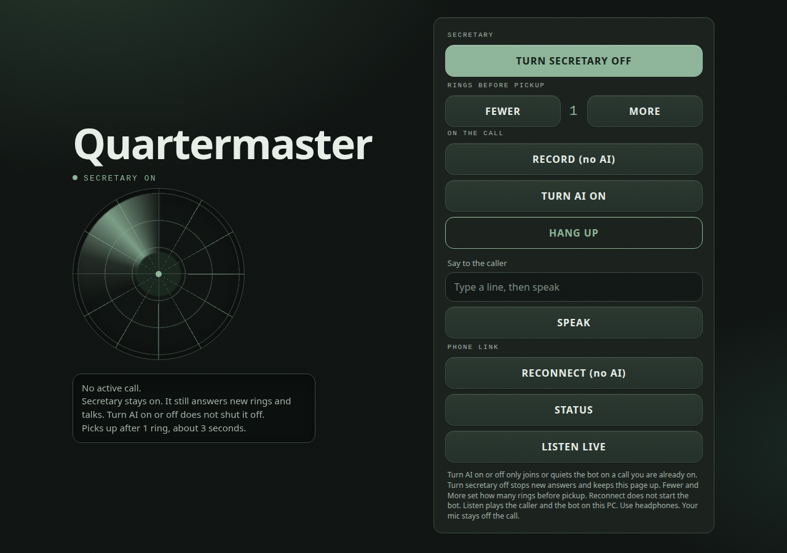

# ⚓ QUARTERMASTER

> *Every ship needs a voice at port. This one never sleeps, never drinks (much),
> and always takes a message for the owner.*

Free to use. If it saved you time, tips are welcome: [Cash App](https://cash.app/$jollyroger1480) or Bitcoin `bc1qydycnf5pjhez5d0mrgmmumyv2g5nc63mwet89j`. More links at the [bottom](#support-and-links).

**Quartermaster** is a self-hosted AI receptionist for your shop's phone. It
was built and configured on **Linux**. It will not run on Windows as shipped.
A Windows box would need a different Bluetooth call-audio path and a different
way to start the watcher.

It answers incoming **calls** over Bluetooth and holds a real conversation.
It talks from your shop notes, looks up order status, takes a message, and it handles
**SMS texts** the same way. Every exchange lands in your pocket via Telegram,
with compressed audio and a transcript archived on disk.

Built on a real salvage shop's phone line, where it now answers while the
owner is elbow-deep in an engine bay. Your shop name, your name, hours and
location all come from `callscoot.toml`, so it works for any small shop.


Shop: [Buccaneer Salvage](https://buccaneersalvage.github.io/), Carbondale, PA.
Hours are by appointment.

```
        Caller
          ⇅  cellular
        Android phone          ← plugged into the bench, screen can sleep
          ⇅  Bluetooth HFP     ← voice (bluez-alsa)
        Linux box              ← whisper STT → knowledge base → LLM → TTS
          ⇅  wireless ADB      ← control channel (answer / hang up / SMS DB)
        Telegram               ← "☎️ CALL — (number): what they said"
```

Bluetooth is the path this repo runs. If you want a Google Voice number
instead of a paired phone, that is a separate optional app. See
[Optional: Google Voice](#optional-google-voice-instead-of-bluetooth).

---

## What it does

**Calls** — rings once, answers, greets, listens, thinks (soft blip), replies
in a natural voice. Knows your services and hours, answers order questions
from live data, takes messages with callback details, hangs up on "bye",
declines scam scripts mid-sentence, and never promises refunds, dates, or
your home address.

**Parts calls** — a caller hunting for a part gets written down properly:
year, make, model, the part, a part number if they have one (asked to text
it so it is not misheard), and a callback number. It reads the request back
and says the shop will get back to them if one turns up. It never quotes a
price, condition, fitment, or a time on the phone. The request is saved to
`leads/` (`callscoot leads` lists the open ones) and sent to you as a card.

**Texts** — reads every incoming SMS over ADB, replies with the same brain,
loop-protected and contact-aware (saved contacts = personal, never
bot-replied). Per-number hourly and daily reply caps. An optional stock CSV
(`sms.stock_file`) lets it point a texter at a matching listing.

**For the owner** — Telegram alert after every call or text that took a
message: the number, what they wanted, escalation flag if it smelled like a
dispute or damage. Audio + transcript archived per call (`logs/`). A caller
who asks for you by name ("is Sam there?") or is fed up with the bot gets a
fast way out: the bot offers to take a message and the alert is flagged for
you personally.

**Live call controls** — while a call is up, the bench panel and the
Telegram alert card have buttons to record, let the AI join or step back,
and hang up. A plain message you type in the alert chat during a call is
spoken to the caller.

**Spam and robocalls** — one scored check (scripted sales and scam phrases
against customer words) declines and hangs up on robocalls and
telemarketers, on calls and texts alike. After the call a second check
confirms it before a record is kept (`callscoot robocalls`).
`python3 -m callscoot.dnc_report` can file a saved record with the FTC Do
Not Call form; it is a dry run unless you pass `--send`, and it needs
`phone.own_number`.

**Caller memory, safely** — a repeat caller's prompt gets the topic of
their last call and how many times the number texted lately, never the text
of those messages, because caller ID can be spoofed.

**Retention** — call audio and transcripts are deleted after
`logs.retention_days` (7 in the example) and part requests after
`leads.retention_days` (30). `callscoot prune` runs it by hand.

**Gaming mode** — one click (or `callscoot gaming on`) drops the heavyweight
voice model and swaps to a featherweight one so a 6 PM call never taxes your
GPU rig.

**Privacy, enforced in code** — answers come *only* from your knowledge files
and order data. No internet search. Saved contacts never get bot replies.
The bot cannot book times, promise refunds, or state your home address —
those rules are in the prompt *and* the guardrails.

## Optional: Google Voice instead of Bluetooth

The default receptionist needs an Android phone on Bluetooth. Answer, hang
up, and caller ID ride the headset link itself — **no wireless debugging
needed for calls**; that is only for texts. That is the shop line this was
built on.

If you do not have that phone, [Ewalt's Auto Tuning](https://www.ewaltsautotuning.com/)
Shop Assistant answers a **Google Voice** number from a Chrome window. It
ships in [`optional/google-voice/`](optional/google-voice/) under his MIT
license. It is a second app. It does not replace `callscoot watch`, and it
does not read `callscoot.toml`.

```bash
cd optional/google-voice
./install.sh
```

Setup, the Voice sign-in, and the limits (Google can change the page and
break it) are in
[optional/google-voice/README.md](optional/google-voice/README.md).

## Bench panel

`callscoot watch` serves this page on the same computer only:
[http://127.0.0.1:8795](http://127.0.0.1:8795). It does not listen on the LAN.



| Button | What it does |
|---|---|
| TURN SECRETARY OFF | Stops answering new rings. The page stays open. A call you are already on stays up. If the bot is talking, it goes quiet. |
| FEWER / MORE | How many rings before pickup. One ring is `call.ring_delay_s` (3 seconds in the example). The count is 1 to 8 and sticks across a restart in `logs/rings`. |
| TURN AI ON / OFF | Joins or quiets the bot on a call that is already up. It does not shut the secretary off. |
| RECORD (no AI) | Records a call you already picked up. The bot does not start talking. |
| RECONNECT (no AI) | Brings the Bluetooth phone link (and wireless debugging, if you use texts) back. It does not start the bot. |
| STATUS | Phone link, call state, headset, and whether listen is on. |
| LISTEN LIVE | Plays the caller and the bot on this PC. Use headphones. Your mic stays off the call. |
| HANG UP / SPEAK | Ends the call, or says the line you typed. |

Turning the secretary off writes `logs/secretary.off`. That file is gitignored, and the choice sticks across a restart. Press the button again and new rings are answered.

---

## Requirements

| What | Notes |
|---|---|
| Linux PC + Bluetooth adapter | tested on Mint 22 / PipeWire 1.x, 16 threads |
| Android 11+ phone | spare/bench phone, SIM active, on the same Wi-Fi |
| Phone + PC paired over Bluetooth | the PC acts as the phone's **headset** |
| Wireless debugging (optional) | only if you want texts: Developer options → pair once |
| mic + speakers or headset | on the PC (this is the phone's "headset") |
| API keys (optional) | any OpenAI-compatible LLM endpoint; Groq free tier works |
| Telegram | a bot you create, plus one chat, group, or forum topic for alerts |
| Python 3.11+ | stdlib only for the core; whisper/kokoro installed separately |

> **Heads-up:** this stack was tuned on a real phone and it works, but Linux
> Bluetooth HFP is famously moody. The troubleshooting section covers the
> traps that bit during development.

---

## Setup — the phone (5 minutes)

1. **Pair the phone and PC over Bluetooth** (Settings → Bluetooth → tap the
   PC). Allow **call audio** when prompted.
2. **Wireless debugging — optional, texts only.** Calls work without it. If
   you want the bot to read and send texts, tap Build number ×7 in About
   phone, enable **Wireless debugging**, and pair from the PC:
   ```bash
   adb pair PHONE_IP:PAIR_PORT     # 6-digit code from the phone
   callscoot adb-connect
   ```
3. **Turn OFF RCS chat features** — critical! Messages app → profile avatar →
   Messages settings → **RCS chats** → toggle off. RCS texts are invisible to
   ADB; with it off, everything arrives as plain SMS where the bot lives.
4. **Save your unlock PIN** (so the bot can open the messaging app to send
   replies — the file never leaves the machine):
   ```bash
   # run inside the quartermaster folder (see "Setup — the PC")
   read -s -p "phone PIN: " P && printf '%s' "$P" > .pin && chmod 600 .pin && unset P
   ```
5. Put the phone **on a charger** on the bench. Done — no cable ever again.

## Setup — the PC (10 minutes)

```bash
git clone https://github.com/jollyroger1480/quartermaster.git
cd quartermaster

# 1. Bluetooth call-audio daemon (HFP) — the part Linux makes hard
sudo bash scripts/install-bluealsa.sh

# 2. Python brains
pip install --user --break-system-packages requests faster-whisper kokoro espeakng-loader phonemizer-fork
pip install --user --break-system-packages "https://github.com/explosion/spacy-models/releases/download/en_core_web_sm-3.8.0/en_core_web_sm-3.8.0-py3-none-any.whl"

# 3. Also install piper (fallback voice) and put a voice model in ~/.local/share/piper/
#    (any voice works — it only speaks when kokoro hiccups)

# 4. Configure
cp callscoot.example.toml callscoot.toml
$EDITOR callscoot.toml          # [persona] shop, owner, hours, location; [audio] phone MAC

# 5. Keys — loaded automatically at startup. Telegram steps are the next section.
$EDITOR .env                    # GROQ_API_KEY=...  ZAI_API_KEY=...  TELEGRAM_BOT_TOKEN=...

# 6. Health check
bin/callscoot doctor
```

## Your own model

Any server that speaks the OpenAI chat API can answer the phone. You do not
edit Python, and you do not need anyone to wire a provider in for you.

```bash
bin/callscoot llm-add \
  --name mine \
  --base-url https://api.example.com/v1 \
  --model my-model \
  --api-key-env MY_LLM_KEY \
  --api-key 'paste-key-here'
```

That writes `callscoot.llm.toml` next to `callscoot.toml`. Providers in that
file are tried first. The first one that answers is the one the phone uses.
The key is stored in `.env`. Both files stay off git.

Hand edit works too. Copy `callscoot.llm.example.toml` to `callscoot.llm.toml`
and change the four lines. Local Ollama needs no key:

```bash
bin/callscoot llm-add \
  --name ollama \
  --base-url http://127.0.0.1:11434/v1 \
  --model llama3.1 \
  --api-key-env ''
```

Check the model without placing a call:

```bash
bin/callscoot ask "What are the shop hours?"
```

The line above the answer names the provider that spoke.

## Once it is configured

```bash
bin/callscoot doctor
bin/callscoot watch
```

Leave `watch` running, or install the user systemd unit in `systemd/` so it
comes back after a reboot. Then open the bench panel on that same computer:

`http://127.0.0.1:8795`

The secretary answers new rings. Turn secretary off when you want the phone
to ring through. Fewer and More set how many rings to wait. Record does not
make the bot talk. Turn AI on only joins a call you already picked up.
Listen plays the call on this PC. Use headphones.

`callscoot ask` is the same brain with no phone in the loop. Use it when you
change the model or the shop notes and want to hear what it will say.

## Setup — Telegram

Calls and texts still get answered, and the transcript still lands in
`logs/`, if Telegram is not set up. The digest on your phone is a separate
step. Quartermaster posts alerts, and it reads only one chat: the alert chat
you configure, for the call-control buttons and the lines you type to a
caller during a call. Messages from any other chat are ignored.

1. Install Telegram on the phone that should get the alerts. That can be the
   shop phone or any other phone you carry.
2. In Telegram, open **@BotFather**, send `/newbot`, and follow the prompts.
   Copy the token. It looks like `123456789:AA...`. Treat it like a password.
3. Put it in `.env` next to `callscoot.toml` (this file is git-ignored):
   ```bash
   umask 077
   printf 'TELEGRAM_BOT_TOKEN=%s\n' 'paste-token-here' >> .env
   ```
4. Open a chat the bot is allowed to post in:
   - **Private:** open your new bot and tap **Start**. Until you do, Telegram
     refuses the send.
   - **Group:** make a group, add the bot, and send one message in the group.
   - **Forum topic:** turn Topics on for that group, add the bot, and send
     one message inside the topic you want.
5. Ask Telegram for the id. From the same directory, after that message:
   ```bash
   set -a; source .env; set +a
   curl -s "https://api.telegram.org/bot${TELEGRAM_BOT_TOKEN}/getUpdates"
   ```
   In the JSON, `chat.id` is the destination. A private chat is a positive
   number. A group starts with `-100`. Inside a forum topic, also copy
   `message_thread_id`.
6. Tell Quartermaster where to post. Either line works. The toml value wins
   when it is not empty.
   ```bash
   # .env  — whole chat
   echo 'TELEGRAM_HOME_CHANNEL=-1001234567890' >> .env
   # .env  — one forum topic (chat id, a colon, topic id)
   echo 'TELEGRAM_HOME_CHANNEL=-1001234567890:3' >> .env
   ```
   Or set `alerts.telegram_chat` in `callscoot.toml` to that same string.
   Leave `alerts.telegram = true`.
7. Prove the bot can post before you trust a live call. A chat with no topic:
   ```bash
   set -a; source .env; set +a
   curl -s -X POST "https://api.telegram.org/bot${TELEGRAM_BOT_TOKEN}/sendMessage" \
     --data-urlencode "chat_id=${TELEGRAM_HOME_CHANNEL}" \
     --data-urlencode "text=Quartermaster test"
   ```
   A forum topic (`chatid:topicid` in `TELEGRAM_HOME_CHANNEL`):
   ```bash
   set -a; source .env; set +a
   curl -s -X POST "https://api.telegram.org/bot${TELEGRAM_BOT_TOKEN}/sendMessage" \
     --data-urlencode "chat_id=${TELEGRAM_HOME_CHANNEL%%:*}" \
     --data-urlencode "message_thread_id=${TELEGRAM_HOME_CHANNEL#*:}" \
     --data-urlencode "text=Quartermaster test"
   ```
   A working send returns `"ok":true`, and the message shows up in Telegram.

After a real call or text, the watcher posts a short digest: who called, what
they said, and `transcript: <path on this computer>`. The phone can read that
message. It cannot open the `.md` file, because that path is on the shop
computer, not on the phone.

## Setup — the knowledge (this is the magic)

The bot answers **only** from the folder `vault.root` points at and from your
config. By default that is the `knowledge/` folder inside the program folder.
The `.example.md` files there are templates; the bot only reads your copies.

- `knowledge/services.example.md` — copy to `knowledge/services.md` and put your real services in it
- anything else you drop in that folder — policies, FAQs, parts notes, whatever
- optional: wire `[orders]` in the config to a live order export and the bot
  answers "where's my order" from real records, buyer-name matched

If the answer isn't on file, the bot says so and takes a message.

**Prices are yours to set.** The bot never states, estimates, negotiates, or
confirms a price, a discount, a quote, or a shipping cost, on a call or a
text. A price question gets a fixed hand-off line (`call.price_reply` /
`sms.price_reply` to change the wording): it takes the part, the vehicle, and
the name, and says you will get back to them with a price. This is enforced in
code, not only in the prompt: money amounts are stripped from the notes before
the model sees them, and any reply that still names a price is replaced with
the hand-off line and logged. Your alert is tagged `PRICE REQUEST`.

How to write the service notes, the hours, and the lines the model is not allowed
to rewrite: [Business guardrails](docs/business-guardrails.md).

## Run it

```bash
bin/callscoot watch          # auto-answer + auto-text. Ctrl+C to stop.
```

Run at boot:

```bash
cp systemd/callscoot-watch.service ~/.config/systemd/user/
# run inside the quartermaster folder: points the unit at this copy
sed -i "s|%h/callscoot|$PWD|" ~/.config/systemd/user/callscoot-watch.service
systemctl --user daemon-reload && systemctl --user enable --now callscoot-watch
journalctl --user -u callscoot-watch -f
```

## CLI

| Command | What it does |
|---|---|
| `callscoot doctor` | checks every layer, prints the exact next fix |
| `callscoot status` | call state + Bluetooth audio nodes |
| `callscoot adb-connect` | (re)connect wireless ADB — texts only |
| `callscoot listen` | capture one utterance from the phone, print the transcription |
| `callscoot ask "question"` | ask the brain a question without a phone call |
| `callscoot index` | refresh the order snapshots |
| `callscoot gaming on/off` | drop the heavy voice model, switch to piper |
| `callscoot unlock` | wake + unlock the phone (saved PIN) |
| `callscoot gui` | open the bench panel (watch must be running) |
| `callscoot leads` | list open part requests (also in `leads/open-leads.md`) |
| `callscoot robocalls` | list saved robocall / telemarketer records, newest first |
| `callscoot prune` | delete recordings, transcripts and old leads past their retention |
| `callscoot llm-add` | add an OpenAI-compatible model and try it first |
| `callscoot answer` / `hangup` | answer or end the current call by hand |
| `callscoot agent` | hand the current ringing or active call to the receptionist |
| `callscoot talk` | talk to the caller yourself through the PC mic and speakers |
| `callscoot watch` | THE switch — live receptionist |

## Configuration

Everything lives in `callscoot.toml` — full annotated reference in
[`callscoot.example.toml`](callscoot.example.toml). Highlights:

| Key | Meaning |
|---|---|
| `phone.allowlist` | numbers always answered; `answer_unknown = false` makes it allowlist-only |
| `call.ring_delay_s` | rings before pickup |
| `record_silence_s` | pause length before the bot thinks it's her turn (1.5 = patient) |
| `tts.backend` | `kokoro` (natural) or `piper` (featherweight) |
| `persona.shop_hours` | the ONLY hours it may speak — empty = it punts instead of inventing |
| `persona.store` | where parts are sold (your online store), as the bot should say it |
| `spam.blacklist` | numbers never answered |
| `spam.hangup_on_scam` | decline and hang up when a call sounds like a robocall or scam |
| `logs.retention_days` | days call audio and transcripts are kept |
| `leads.enabled` | save parts calls as part requests |
| `phone.own_number` | your shop number; only used by the Do Not Call report |
| `alerts.telegram` | `true` sends the digest; `false` keeps transcripts local only |
| `alerts.telegram_chat` | chat id, or `chatid:topicid`; empty uses `TELEGRAM_HOME_CHANNEL` |

Keys go in `.env` (git-ignored): `GROQ_API_KEY`, `ZAI_API_KEY`,
`TELEGRAM_BOT_TOKEN`, `TELEGRAM_HOME_CHANNEL`. See **Setup — Telegram**.

## Tests

The suite needs only `pytest` and `requests`, no phone, no models, no keys:

```bash
pip install --user --break-system-packages pytest requests
python3 -m pytest -q tests
```

The tests run in a throwaway home folder, so they never touch your
`callscoot.toml`, `logs/` or `knowledge/`.

## Troubleshooting (the traps we fell into so ye don't have to)

- **"Phone audio" missing on the phone's Bluetooth page** → the PC isn't
  advertising hands-free. Check `bluealsad` is running with `-p hfp-hf` and
  re-pair the phone.
- **Phone notification sounds play on the PC speakers** → the PC accepted
  A2DP, so the phone treated it as a Bluetooth speaker. Call audio is HFP
  only. `scripts/install-bluealsa.sh` installs `systemd/bluealsa-hfp-only.conf`
  and `systemd/wireplumber-no-a2dp.conf` so media audio is not offered.
  Restart BlueALSA and WirePlumber after copying those files onto an older
  install.
- **Caller silent / no audio nodes** → an A2DP-vs-HFP profile fight. Force
  the headset role: `bluez5.headset-roles = [ hfp_hf ]` in WirePlumber config.
- **One-way audio (call answered, but one side hears nothing)** → run the
  read-only probe, then make one test call:
  ```bash
  bin/callscoot-probe 2      # waits up to 2 hours for the next call
  # or detached: systemd-run --user --unit=callscoot-probe bin/callscoot-probe
  ```
  It writes `logs/probe_<date>/`: `timeline.log` (SCO counters, codec,
  volume and mute twice a second), `summary.txt` (read this first: the call's
  timeline ends and the playback lines from `errors.log`) and, with
  passwordless sudo, an HCI trace `hci.btsnoop`. With the trace, the summary
  also counts SCO packets each way, so a direction stuck at zero shows which
  side went silent. It never sends commands to the phone.
- **Choppy voice** → disable mSBC (`bluez5.enable-msbc = false`), fall back
  to CVSD. Narrowband is fine for calls.
- **Can't see texts in the bot** → RCS is on. Turn chat features OFF
  (see phone setup step 3). RCS never touches the SMS database.
- **Bot replies to your friends' texts** → that's the contacts guard being
  off; saved contacts are skipped by default.
- **Bot cut someone off mid-sentence** → raise `record_silence_s`.
- **First response slow** → that's the models cold-loading; keep the watcher
  running (it pre-warms at startup).
- **`alert skipped: telegram not configured`** → `.env` has no
  `TELEGRAM_BOT_TOKEN`, or both `alerts.telegram_chat` and
  `TELEGRAM_HOME_CHANNEL` are empty. Setup — Telegram, steps 3 and 6.
- **`telegram send failed` / HTTP 401** → the bot token is wrong. Ask
  @BotFather for `/token` and replace the line in `.env`.
- **HTTP 400 chat not found, or HTTP 403** → the bot is not in that chat, the
  id is from a different bot, or you never tapped Start in a private chat.
  For a topic, `message_thread_id` has to be the number from `getUpdates`,
  not the topic's name.
- **The Telegram message arrived but the `.md` link does nothing** → the
  digest includes a file path on the shop computer. The phone has nowhere to
  open it. The message text is the whole alert.
- **Something failed and the journal is only one line** → debug logging is on.
  `logs/errors.log` (same folder as the call transcripts) has the watch lines
  and the traceback. The same error is written once, then counted, so a retry
  loop does not fill the file. Set `CALLSCOOT_LOG=INFO` to quiet the debug lines.

---

## Support and links

This project is free, and a tip is welcome but never expected.

- Tip (Cash App): [$jollyroger1480](https://cash.app/$jollyroger1480)
- Bitcoin: `bc1qydycnf5pjhez5d0mrgmmumyv2g5nc63mwet89j`
- eBay store: [Buccaneer Salvage](https://www.ebay.com/str/buccaneersalvage)
- YouTube: [@BuccaneerSalvage](https://www.youtube.com/@BuccaneerSalvage)
- X: [@jollyroger1480](https://x.com/jollyroger1480)

## License

[MIT](LICENSE) — do what ye will. Built and bloodied on a real shop line by
[jollyroger1480](https://github.com/jollyroger1480) of
[Buccaneer Salvage](https://buccaneersalvage.github.io/).

Call-flow ideas — waiting out a half sentence, the after-call slip, and sharper note search — came from [Ewalt's Auto Tuning](https://www.ewaltsautotuning.com/).

Full provider and component credits: [CREDITS.md](CREDITS.md).
